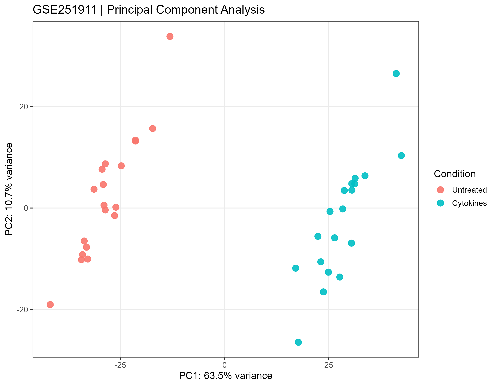
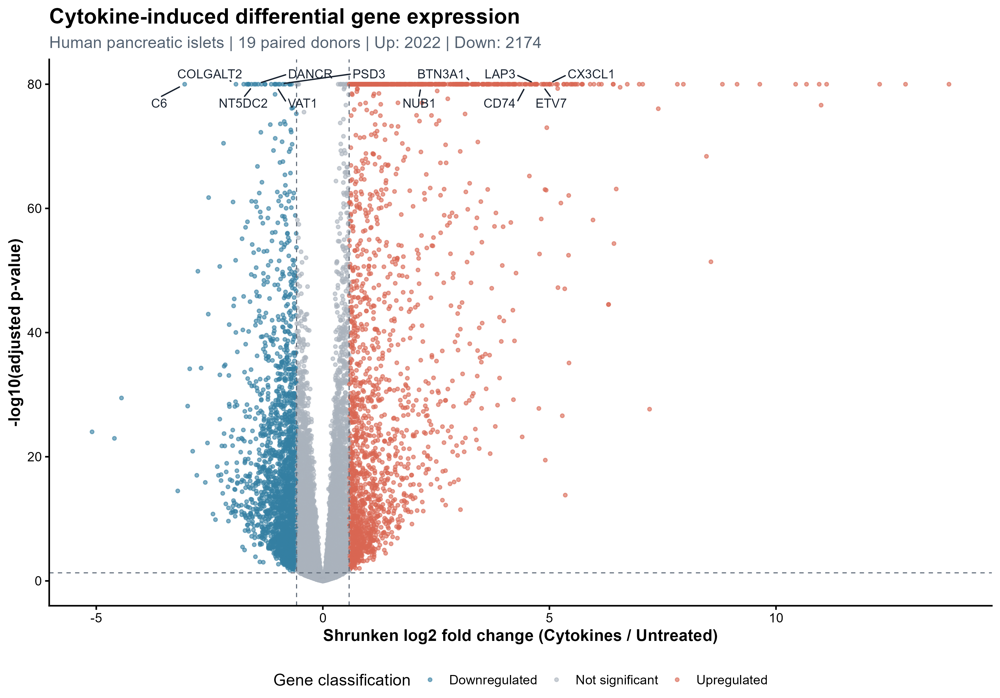
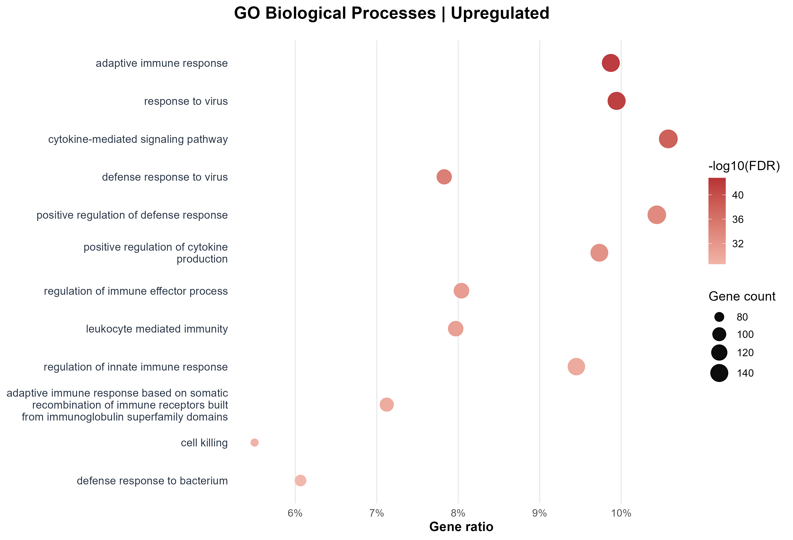
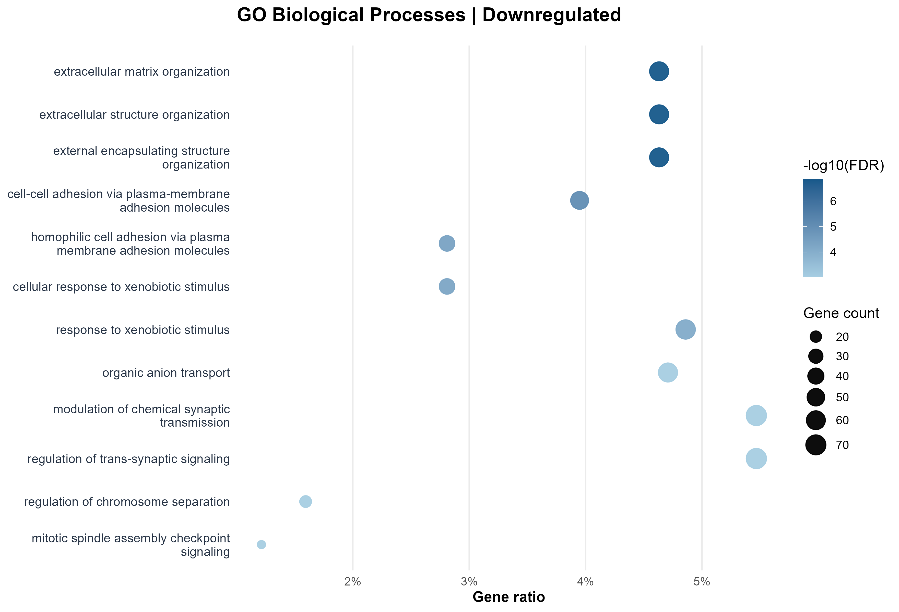

# Cytokine-Induced Transcriptomic Changes in Human Pancreatic Islets

**Bulk RNA-seq analysis | GSE251911 | DESeq2 | Gene Ontology**

An R-based analysis of the transcriptional response of human pancreatic islets to inflammatory cytokine exposure. This project examines differential gene expression and the biological processes associated with treatment, using a paired-donor design and publicly available RNA-seq data.

**Dataset:** [NCBI GEO — GSE251911](https://www.ncbi.nlm.nih.gov/geo/query/acc.cgi?acc=GSE251911) &nbsp;·&nbsp; **Comparison:** Cytokines vs Untreated &nbsp;·&nbsp; **Design:** 19 matched donor pairs

---

## Research question

**How does a 24-hour inflammatory cytokine treatment alter gene expression and associated biological processes in human pancreatic islets?**

Each donor contributes an untreated sample and a cytokine-treated sample. Pairing allows the analysis to account for differences in baseline expression between donors while estimating the treatment-associated effect.

## Study at a glance

| Feature | Description |
| :-- | :-- |
| Biological system | Primary human pancreatic islets |
| Data type | Bulk RNA sequencing |
| Experimental groups | Untreated and cytokine-treated (24 h) |
| Samples included | 38 samples from 19 donors |
| Statistical design | `~ donor_id + condition` |
| Main analyses | QC, PCA, hierarchical clustering, DESeq2, GO Biological Process enrichment |
| Reference group | Untreated |

## Analysis workflow


### Differential expression criteria

| Analysis setting | Value |
| :-- | :-- |
| Low-count prefilter | At least 10 raw counts in at least 19 samples |
| Statistical model | `~ donor_id + condition` |
| Normalization / testing | DESeq2 size factors and negative binomial Wald test |
| Log2 fold-change shrinkage | `apeglm` |
| Multiple-testing correction | Benjamini–Hochberg |
| DEG criteria | Adjusted *p* < 0.05 and \|shrunken log2FC\| ≥ 0.58 |
| Direction | Positive log2FC = higher expression after cytokine treatment |
| GO enrichment | `clusterProfiler::enrichGO`, Biological Process, separate Up/Down gene sets |
| GO background | Genes with a non-missing DESeq2 adjusted *p*-value, subject to annotation availability |

## Key findings

### Global transcriptomic response

PCA reveals a pronounced separation between untreated and cytokine-treated samples, with **PC1 explaining 63.5%** and **PC2 explaining 10.7%** of the plotted variance. This indicates a strong treatment-associated expression pattern; PCA itself does not establish a causal mechanism or rule out every technical confounder.



### Differential gene expression

After low-count filtering, **21,172 genes** were retained for testing from an initial count matrix containing 60,560 gene features.

| Result | Number of genes |
| :-- | --: |
| Differentially expressed genes | **4,196** |
| Upregulated in cytokine-treated samples | **2,022** |
| Downregulated in cytokine-treated samples | **2,174** |



The volcano plot shows shrunken log2 fold changes against adjusted *p*-values. Positive values denote higher expression under cytokine treatment; negative values denote lower expression.

Additional visualizations: [MA plot](Figures/MA_plot.png) · [Top-30 DEG heatmap](Figures/top30_DEG_heatmap.png) · [Sample clustering dendrogram](Figures/hierarchical_clustering.png)

### Gene Ontology: Biological Process

GO enrichment was performed **separately** for the upregulated and downregulated gene sets using tested genes as the background.

| Gene set | Significant GO-BP terms (BH-adjusted *p* < 0.05) | Representative enriched processes |
| :-- | --: | :-- |
| Upregulated | **903** | Cytokine-mediated signaling, adaptive immune response, response to virus, immune regulation |
| Downregulated | **106** | Extracellular matrix organization, cell adhesion, xenobiotic response, transport-related processes |

**Upregulated genes**



**Downregulated genes**



The results are consistent with substantial inflammatory and interferon-associated transcriptional changes, together with reduced expression of genes involved in extracellular organization and selected cellular functions. The GO term *response to virus* can reflect an interferon-associated expression program and is **not** evidence that these samples were infected by a virus. Enriched GO terms overlap extensively and should not be interpreted as independent biological mechanisms.

## Repository contents

```text
GSE251911-RNAseq-Analysis/
├── Figures/          # PCA, dendrogram, DEG plots and GO plots
├── Metadata/         # Sample metadata and sample-matching information
├── Results/          # Differential-expression and GO enrichment tables
├── Scripts/          # R scripts for metadata, RNA-seq and GO analysis
├── sessionInfo.txt   # R session and package versions
└── README.md
```

The main result tables include:

- [`Significant DEGs.csv`](Results/Significant%20DEGs.csv) — differentially expressed genes selected using the specified FDR and fold-change thresholds.
- [`GO_BP_Upregulated.csv`](Results/GO_BP_Upregulated.csv) — GO Biological Process enrichment of upregulated genes.
- [`GO_BP_Downregulated.csv`](Results/GO_BP_Downregulated.csv) — GO Biological Process enrichment of downregulated genes.

Sample information is available in [`metadata.csv`](Metadata/metadata.csv) and [`clean_metadata.csv`](Metadata/clean_metadata.csv).

## Reproducibility

The analysis uses **R** and the following principal packages: `GEOquery`, `DESeq2`, `apeglm`, `clusterProfiler`, `org.Hs.eg.db`, `ggplot2`, `ggrepel`, and `pheatmap`. Session details are documented in [`sessionInfo.txt`](sessionInfo.txt).

To rerun the analysis:

1. Obtain the GEO sample metadata and [raw count matrix](https://ftp.ncbi.nlm.nih.gov/geo/series/GSE251nnn/GSE251911/suppl/GSE251911_CYT_RNA-seq_Raw_Count_Matrix.txt.gz).
2. Run the R scripts in `Scripts/` in this order: **metadata preparation → count alignment and RNA-seq/DESeq2 analysis → GO enrichment**.
3. Check that file paths in the scripts point to the corresponding `Metadata/` and `Results/` locations before execution. The analysis scripts use relative paths, so their working directory matters.
4. Compare the regenerated figures and CSV results with the outputs in this repository.

## Data availability

The source dataset is publicly available through the **NCBI Gene Expression Omnibus**, accession **[GSE251911](https://www.ncbi.nlm.nih.gov/geo/query/acc.cgi?acc=GSE251911)**. All results presented here refer to the selected **19 matched untreated/cytokine-treated donor pairs**. The dataset and its original depositors remain credited through the GEO record.
